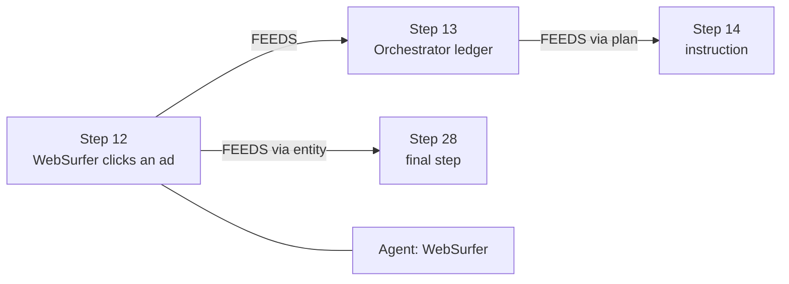

# Butterfly

**Find the flap that caused the storm.** When a team of AI agents fails a task, Butterfly finds which agent made the decisive mistake, at which step, and, when the graph links the two, shows the chain of steps that carried that mistake to the failure as a FalkorDB path you can re-run.

**Try it:** [butterfly-falkordb.netlify.app](https://butterfly-falkordb.netlify.app), a recorded copy of the app with every answer captured from FalkorDB; `docker compose up` runs it live (see *Quickstart*).

Built for [Graph Hacks: Context for AI Agents](https://www.wemakedevs.org/hackathons/falkordb) (WeMakeDevs x FalkorDB). **Track: Agents That Act on Connected Data.**

**In one line:** on 184 real, human-labelled multi-agent failures from a public benchmark (Who&When, ICML 2025, not faults we planted), Butterfly finds the decisive step as often as the strongest whole-log method, names the responsible agent more often (62.5% vs 53.8%), sends the LLM half the tokens, and for 66 of the 184 answers shows the dependency chain from the failure back to the mistake as a graph path. With no LLM at all, the graph alone finds the step 28% of the time.

<!-- RESULTS:START -->
## Results on all 184 Who&When failures

Same model (gpt-5.4-mini) for every LLM method, no ground truth in any prompt, exact-step scoring, 95% bootstrap confidence intervals. Reproduce with the commands under *Quickstart*.

| Method | Right step | 95% CI | Right agent | LLM input per run |
|---|---|---|---|---|
| Earliest plausible step (no graph, no LLM) | 11.4% | 7.1%–16.3% | 43.5% | none |
| Step-type prior only (no graph, no LLM) | 15.8% | 10.9%–21.2% | 51.1% | none |
| gpt-5.4-mini reads the whole log (official Who&When prompt) | 16.3% | 11.4%–21.7% | 56.0% | 7.6k tokens |
| gpt-5.4-mini reads the whole log, steps numbered (strongest baseline) | 33.2% | 26.1%–40.2% | 53.8% | 7.8k tokens |
| **Butterfly, graph only (no LLM)** | 28.3% | 21.7%–34.8% | 58.2% | none |
| **Butterfly, graph + one gpt-5.4-mini call** | 34.8% | 27.7%–41.8% | 62.5% | 3.8k tokens |

What this shows, against the strongest baseline (paired exact McNemar tests on the same 184 runs):

- **Finding the step: a tie.** Butterfly 34.8% vs 33.2% (right only for Butterfly 27, only for the baseline 24, p = 0.78).
- **Naming the responsible agent: Butterfly is better.** 62.5% vs 53.8% (35 vs 19, p = 0.04).
- **Cost: 51% fewer LLM input tokens**, and 58% fewer on the long hand-crafted runs.
- **Evidence:** for 66 of 184 answers, FalkorDB returns the dependency chain from the failure back to the mistake. For the rest the graph finds no direct chain, and the app says so instead of drawing one. The baseline gives prose either way.
- **Without any LLM**, the graph alone finds the step 28.3% of the time.

Against the benchmark's official prompt, Butterfly roughly doubles step accuracy (44 vs 10, p = 3e-06). Most of that gap comes from the official prompt asking the model to count steps itself: the same model is right within one step far more often than exactly. That is why the numbered baseline above is the fair comparison.

Per split:

| Split | Method | Right step | Right agent | LLM input per run |
|---|---|---|---|---|
| Generated (126 runs, ≤10 steps) | Strongest baseline | 39.7% | 57.1% | 3.4k |
| Generated (126 runs, ≤10 steps) | Butterfly, graph only | 32.5% | 57.9% | none |
| Generated (126 runs, ≤10 steps) | Butterfly | 40.5% | 62.7% | 2.2k |
| Hand-crafted (58 runs, up to 130 steps) | Strongest baseline | 19.0% | 46.6% | 17.3k |
| Hand-crafted (58 runs, up to 130 steps) | Butterfly, graph only | 19.0% | 58.6% | none |
| Hand-crafted (58 runs, up to 130 steps) | Butterfly | 22.4% | 62.1% | 7.2k |
<!-- RESULTS:END -->

## The problem

Multi-agent systems fail quietly. One agent misreads a page at step 12, the others build on it, and the failure only shows at step 29. Debugging means scrolling a log of 30 to 130 messages. Handing the whole log to an LLM is the standard fix, and it gets worse as logs get longer: on the Who&When benchmark, GPT-4o named the right step 3.5% of the time on long hand-crafted runs.

## What Butterfly does

1. **Turns each run into a graph, without an LLM.** Every message is a `Step`. When a later step reuses a URL, file name, number or name that an earlier step introduced, follows its instruction, or reads its tool output, Butterfly adds a `DEPENDS_ON` edge. Each run gets its own graph in FalkorDB.
2. **Lets the graph pick the suspects.** Cypher and FalkorDB's built-in algorithms score every step by how much of the rest of the run builds on it (`algo.BFS`), whether the final step depends on it, how many new facts it introduced, and how early it happened.
3. **Asks one LLM call to choose.** The model reads only the top suspects in full and one-line summaries of everything else, then names the earliest step whose correction would have saved the run.
4. **Looks for the chain.** `shortestPath` over `DEPENDS_ON` returns the chain from the failure back to the chosen step when one exists (66 of 184 answers): the storm track. A chain shows the failure depended on that step; whether the step was *wrong* is decided by the ranking and the LLM call, and the app shows "no direct chain" rather than inventing one.

Take FalkorDB out and steps 1, 2 and 4 disappear: no dependencies, no ranking, no proof. What is left is the baseline below.

## Graph model

One graph per failed run, named `butterfly:<run_id>`.

```
(:Run {id, split, question, n_steps})
(:Step {idx, agent, kind, candidate, rel_pos, chars, preview, new_entities, tool_error_next, is_final})
(:Agent {name})
(:Entity {key, kind})                          URL | file | number | quote | name

(:Step)-[:BY]->(:Agent)
(:Step)-[:NEXT]->(:Step)                        conversation order
(:Step)-[:INTRODUCES]->(:Entity)                first mention of a fact
(:Step)-[:DEPENDS_ON {via, weight, entities}]->(:Step)
        via = entity | instruction | plan | observes | executes | tool_result
(:Step)-[:FEEDS]->(:Step)                       DEPENDS_ON reversed, for forward BFS
```



## The Cypher Butterfly depends on

All queries live in [`butterfly/queries.py`](butterfly/queries.py). Writes use `MERGE`, so the import is safe to re-run. Every read goes through `GRAPH.RO_QUERY` with a 3 second timeout, and the server caps any query at 5 seconds.

How much of the run builds on each candidate step:

```cypher
MATCH (s:Step {candidate: true})
CALL algo.BFS(s, 200, 'FEEDS') YIELD nodes
RETURN s.idx AS idx, size(nodes) AS downstream,
       any(n IN nodes WHERE n.is_final) AS reaches_final
```

Information bottlenecks (computed and returned with each suspect for inspection; not part of the v1 score):

```cypher
CALL algo.betweenness({nodeLabels: ['Step'], relationshipTypes: ['DEPENDS_ON'], samplingSize: 1000})
YIELD node, score
RETURN node.idx AS idx, score
```

The proof, from the failure back to the suspect:

```cypher
MATCH (f:Step {is_final: true}), (s:Step {idx: $idx})
WITH shortestPath((f)-[:DEPENDS_ON*]->(s)) AS p
RETURN [n IN nodes(p) | n.idx] AS steps, [r IN relationships(p) | r.via] AS via
```

Suspect score (computed in [`butterfly/rank.py`](butterfly/rank.py) from the query results):

```
score = prior(step type) × e^(−position) × ln(2 + downstream steps) × ln(2 + new entities)
```

The step-type prior is estimated leave-one-out: a run's own label never informs its own score.

## Quickstart

**One command (Docker only):**

```bash
docker compose up -d --build                  # FalkorDB + Butterfly; open http://localhost:8000
```

The container downloads the benchmark at build time and imports all 184 run graphs on start. Every LLM answer used in the results is cached in `results/cache/`, so the full demo works without an API key. Add `OPENAI_API_KEY` to `.env` only to diagnose with a different model. Behind a TLS-inspecting corporate proxy, build with `EXTRA_CA_FILE=/path/to/ca-bundle.pem docker compose up -d --build`.

**For development** (Docker for FalkorDB, [uv](https://docs.astral.sh/uv/) for Python):

```bash
docker compose up -d                          # FalkorDB v4.22.1 on :6380, Browser on :3000
uv sync
uv run python scripts/fetch_data.py           # downloads the 184 Who&When runs
uv run python scripts/import_runs.py          # builds and loads every run graph
echo "OPENAI_API_KEY=sk-..." > .env           # optional, for the LLM step
uv run uvicorn butterfly.api:app --port 8000  # open http://localhost:8000
```

Reproduce the evaluation:

```bash
uv run python -m butterfly.evaluate --method graph       # graph only, no LLM
uv run python -m butterfly.evaluate --method baseline    # official all-at-once prompt
uv run python -m butterfly.evaluate --method butterfly   # graph + one LLM call
uv run pytest -q
```

## How the evaluation is kept fair

- **Same model** for the baseline and Butterfly, and **no ground truth** in any prompt.
- The baseline prompt is copied from the benchmark's own code (`ag2ai/Agents_Failure_Attribution`, `all_at_once`) with only the "answer is" line removed.
- **Strict scoring:** exact step, case-insensitive agent. The official scorer counts `"12"` as a hit for `"1"` (substring match), and its hand-crafted runs never receive the ground truth because of a field-name mismatch. Butterfly's scorer has neither issue.
- Step-type priors are leave-one-out.
- 95% confidence intervals by bootstrap. The hand-crafted split has only 58 runs, so differences there are close to noise.

## Honest limits

- Entity linking is regex-based. It misses paraphrases and links some unrelated numbers.
- Who&When labels one decisive step per run. Some failures have more than one reasonable answer.
- Recent research systems report higher accuracy on Who&When (graph-based methods such as AIG and DeFA), using larger models and many LLM calls per run. Butterfly's point is the trade-off: most of the work is done by the graph, which is cheap, fast and explainable.

## Built with

FalkorDB v4.22.1, Python, FastAPI, Cytoscape.js, OpenAI. Data: [Who&When](https://huggingface.co/datasets/Kevin355/Who_and_When) (MIT), from *Which Agent Causes Task Failures and When?* (Zhang et al., ICML 2025).

## AI assistance disclosure

This project was built with Claude Code (Anthropic) as a pair-programming assistant, and Zen MCP (GPT and Gemini models) for idea review. The demo video's narration is generated with ElevenLabs. The author chose the idea, the graph model and the evaluation design, reviewed every change, and can explain all of it.

## License

MIT, see [LICENSE](LICENSE). The Who&When dataset is MIT-licensed by its authors; FalkorDB runs from its official Docker image under its own license.
